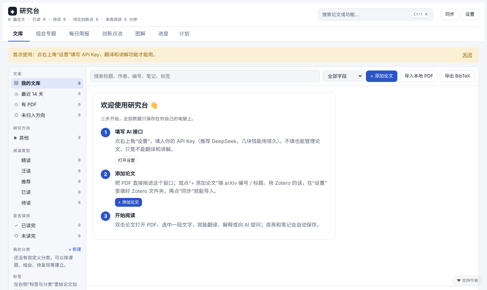
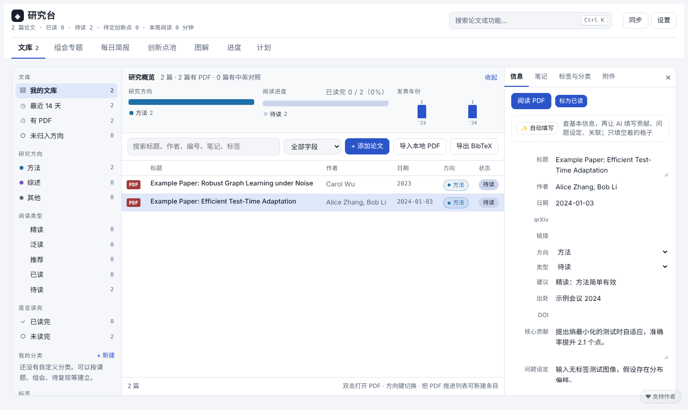

# 研究台

**一个装在自己电脑上的论文阅读助手。** 把论文 PDF 放进来，信息自动填好；选中看不懂的地方，AI 帮你翻译、讲解、回答问题；高亮、笔记、阅读进度都自动保存。适合任何专业，不需要会编程，完全免费。

> ### 📖 第一次用？先看新手操作手册
> **[👉 点这里在线打开《研究台 · 小白操作手册》](https://zhouyyj2-prog.github.io/research-desk/)**
>
> 图文版，每个按钮在哪、点了会怎样都写清楚了，照着点就能用。打不开的话，下载后用浏览器打开 `docs/研究台-小白操作手册.html` 也一样。

## 能做什么

- 📚 **管理论文**：把 PDF 拖进来，或者填 arXiv 编号，就加进文库了；用 Zotero 的话，在设置里填好 Zotero 文件夹，可以一键同步。
- ✨ **信息自动填写**：加进来的论文会自动查好标题、作者、日期、出处（期刊或会议）、DOI 和摘要；填了 API Key 的话，AI 还会读完论文，写好核心贡献、问题设定、和你研究方向的关联，并建议精读还是略读。只填空着的格子，不会覆盖你自己写的内容。
- 📖 **边读边问**：选中一段文字，一键翻译、解释，或者直接问 AI。AI 会结合整篇论文回答，公式也能看懂。
- 🧠 **拆解论文**：一键把整篇论文拆成方法流程、关键概念、实验结果图和自测题，再用大白话讲一遍。
- 🖍️ **高亮和笔记**：划过的重点、写下的想法，下次打开都还在。
- 🗂️ **组会专题**：AI 按主讲论文生成 PPT 大纲、逐字稿和可能被问的问题。
- 📰 **每日简报**：AI 精读文库里的一篇论文，再到 arXiv 找最近的新论文挑几篇给你速览。
- 💡 **创新点池**：记下自己的想法，或者让 AI 从论文里提炼可以改进的方向。
- 🧩 **图解**：让 AI 把难懂的概念做成能拖、能点的讲解网页。
- 📅 **计划**：让 AI 根据你没读完的论文和目标，排好一周每天读什么。
- 🔒 **数据在你自己电脑上**：不用注册账号，论文和笔记不会上传到任何服务器。

## 三步开始

### 第 1 步：下载

点本页面上方绿色的 **Code** 按钮 → **Download ZIP**，下载后**先完整解压**。解压出来的文件夹叫 `research-desk-main`。

### 第 2 步：打开

进入解压后的文件夹，再进入里面的 `research-desk` 文件夹：

| 电脑 | 怎么打开 |
|---|---|
| **Mac** | 双击 `启动研究台.command`。第一次如果提示“无法验证开发者”，就**右键点它 → 打开**。如果弹窗让你安装“命令行开发者工具”，点安装，装完再双击一次。 |
| **Windows** | 先到 [python.org](https://www.python.org/downloads/) 安装 Python（安装界面最下方**勾选 “Add python.exe to PATH”**），然后双击 `启动研究台.bat`。 |

浏览器会自动打开研究台。**用的时候不要关掉那个黑色/白色的命令窗口**，关掉它研究台就退出了。

### 第 3 步：填 AI 接口

翻译、讲解和自动填写都需要接入一个大模型。推荐 DeepSeek，便宜好用：

1. 打开 [platform.deepseek.com](https://platform.deepseek.com/)，用手机号注册登录，充值几块钱。
2. 左侧点 **API keys → 创建 API key**，复制那串以 `sk-` 开头的字符。
3. 回到研究台，点右上角 **设置**，粘贴到 **API Key**，模型名保持默认，点 **保存并测试**，看到“接口可用”就好了。

完成！把 PDF 拖进窗口，论文信息会自动填好，双击就能开始读。

> 不填 API Key 也能用：管理论文、自动查基本信息、高亮和笔记都可以，只是不能用 AI 功能。

## 怎么用（最常用的四件事）

| 想做什么 | 怎么做 |
|---|---|
| 加一篇论文 | 把 PDF 拖进文库；或点 **导入本地 PDF** 一次选好几个；或点 **+ 添加论文** 填 arXiv 编号。信息会自动填好。 |
| 读论文、翻译 | 双击论文打开 PDF，选中一段文字，在弹出的小菜单里点 **翻译 / 解释 / 问 AI**。 |
| 补全以前的论文信息 | 选中论文，在右侧“信息”页点 **✨ 自动填写**。 |
| 一键读懂整篇 | 在阅读器里点 **拆解论文** → **开始拆解**，一两分钟后看结果。 |

更多功能（组会、简报、创新点、图解、计划、全文翻译、手机访问）都在 **[新手操作手册](https://zhouyyj2-prog.github.io/research-desk/)** 里一步步写好了。

## 常见问题

**我的论文和笔记存在哪？怎么备份？**
都在 `research-desk/data` 文件夹里。备份就是把这个文件夹复制一份。研究台每天也会自动备份一次数据库。

**自动填写没填上？**
基本信息来自 arXiv 和 Semantic Scholar：有 arXiv 编号、DOI 或者 PDF 第一页印着编号的论文最容易查到；纯 arXiv 预印本有时没有“出处”。核心贡献等内容需要填 API Key。没填上的，在“信息”页点 **✨ 自动填写** 再试一次，或者自己补上。

**想用别的模型（通义、豆包、Kimi 等）？**
设置 → 服务商选“其他 OpenAI 兼容接口”，填上对应平台给的接口地址、API Key 和模型名。

**怎么按自己的方式分类？**
设置 → **论文分类** 里填你想要的分类，用逗号隔开，比如“综述，方法，实验”，自动填写时 AI 会帮你选。再在 **我的研究方向** 写一句话，AI 讲解论文时会结合你的方向。

**怎么更新到新版本？**
下载新版本后，把旧版本里的 `data` 文件夹复制到新版本的 `research-desk` 里即可，你的论文和笔记都会保留。

**Mac 上双击提示“没有权限”或“无法打开”？**
打开“终端”（在启动台里搜索“终端”），输入 `chmod +x `（注意末尾有个空格），再把 `启动研究台.command` 拖进终端窗口，按回车，然后重新双击它。

**出错了怎么办？**
到本页面的 [Issues](https://github.com/zhouyyj2-prog/research-desk/issues) 描述一下问题，附上截图。

## 进阶功能（可选）

不用也完全不影响使用：

- **全文中英对照翻译**：保留原排版，把整篇论文翻成中英对照版。
  1. 关掉研究台，在 `research-desk` 文件夹里双击 **`安装全文翻译`**（Mac 用 `.command`，Windows 用 `.bat`），等它装完，大约 5–15 分钟。
  2. 重新打开研究台，在阅读器里点“全文翻译”。第一次会再下载一些模型，多等几分钟；默认用免费翻译服务，不需要 API Key，但需要联网。
  - 翻译功能来自开源项目 [PDFMathTranslate-next](https://github.com/PDFMathTranslate/PDFMathTranslate-next)（AGPL-3.0 协议），安装脚本会从 Python 官方源下载它，不包含在本仓库里。已经装了 zotero-pdf2zh 的话，研究台会自动找到，不用再装。
- **手机访问**：设置里勾选“允许手机打开研究台”并设一个密码，重新打开研究台后，手机连同一个 Wi-Fi，打开设置里显示的地址。
- **组会文件夹**：设置里指定一个“组会汇报”文件夹，里面每个子文件夹会自动变成一个组会专题。
- **全自动每日简报**：研究台里点一下就能生成简报；想每天早上自动生成，见 [docs/进阶-每日简报.md](docs/进阶-每日简报.md)。

## 支持作者

研究台**完全免费**，全部功能都能直接用。如果它帮到了你，可以自愿请作者喝杯咖啡，金额随意，非常感谢！

  
  &nbsp;&nbsp;
  

也欢迎点右上角的 ⭐ **Star**，让更多同学看到这个项目。

## 给开发者

- 后端只有一个 `research-desk/app/server.py`：Python 3.8+ 标准库（`http.server` + `sqlite3`），零第三方依赖。
- 前端只有一个 `research-desk/app/static/index.html`：原生 JavaScript，无需构建；PDF.js 渲染 PDF，KaTeX 排版公式。
- AI 走 OpenAI 兼容的 `/chat/completions` 流式接口；论文基本信息来自 arXiv API 和 Semantic Scholar API。
- 端口默认 8765（被占用时启动脚本会自动顺延），可用环境变量 `RD_PORT` 指定。
- 欢迎提 Issue 和 Pull Request。

## 开源协议

[MIT](LICENSE)。附带的第三方组件（PDF.js、KaTeX）遵循各自的协议，见 [THIRD_PARTY_NOTICES.md](THIRD_PARTY_NOTICES.md)。
